# Use Different Docker Container Commands Use the following commands and copy paste their output in readme.md file.

### docker ps' command to list all running containers

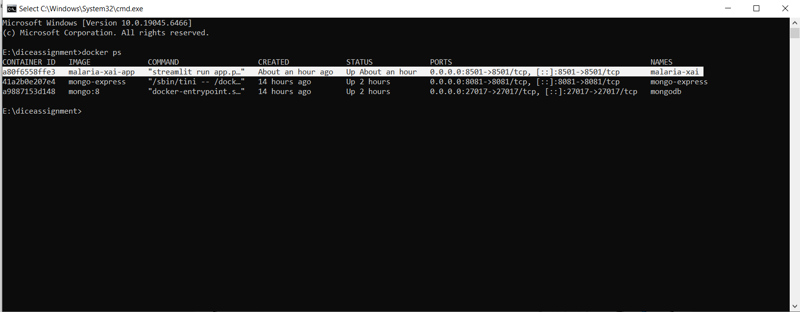
*Description: The `docker ps` command was executed to verify the state of the deployed container. The output confirms that the `malaria-xai` container, built from the `malaria-xai-app` image, is running successfully. It runs the Streamlit application through the command `streamlit run app.py` and has been up for about an hour since it was created. The container's port 8501 is mapped to port 8501 on the host on both IPv4 (`0.0.0.0`) and IPv6 (`[::]`), meaning the application is reachable from the host machine at `http://localhost:8501`. Overall, the finding is that the malaria detection application is deployed and running correctly inside its container, with no errors or restarts.*

### 'docker stop' command to stop a running container 
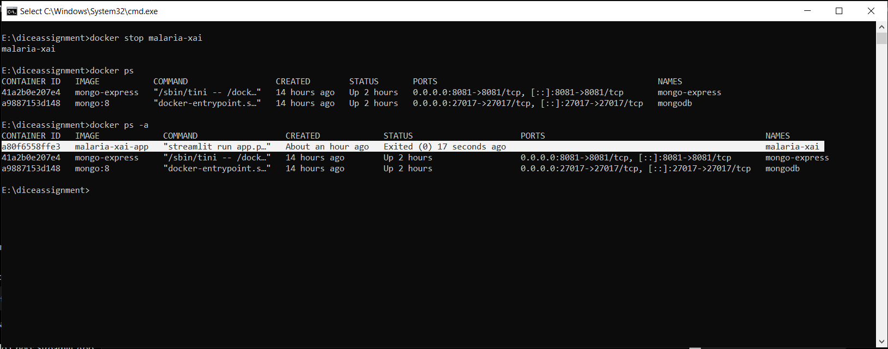
*Description: The docker stop malaria-xai command was executed to stop the running container, and Docker returned the container name to confirm the action. A subsequent docker ps shows that malaria-xai no longer appears in the list of running containers. Running docker ps -a, which lists all containers including stopped ones, shows the malaria-xai container with the status Exited (0) 17 seconds ago and no port mappings. The exit code 0 indicates the container shut down gracefully without errors. Overall, the finding is that the container was stopped successfully but still exists on the system, so it can be started again with docker start malaria-xai.*

### 'docker rm' command to remove a stopped container
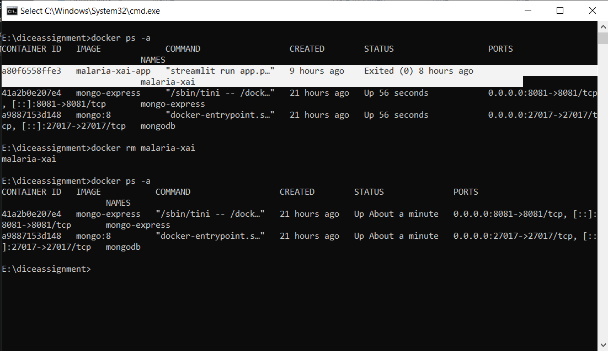
*Description: The docker stop malaria-xai command was used to stop the running container, and Docker confirmed it by returning the container name. The following docker ps no longer lists malaria-xai, while docker ps -a shows it with the status Exited (0) 17 seconds ago and no port mappings. The exit code 0 indicates a clean shutdown, so the container was stopped successfully and remains available to be restarted.*

### 'docker logs' command to view the logs of a container 

#### pull docker image
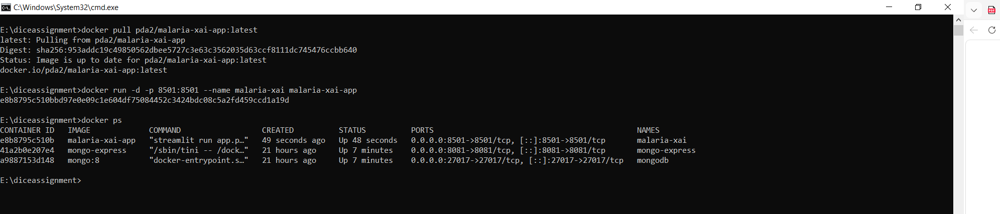
*Description: The docker pull pda2/malaria-xai-app:latest command was executed to fetch the image from Docker Hub, and the status Image is up to date confirms that the latest version was already present locally. The container was then launched with docker run -d -p 8501:8501 --name malaria-xai malaria-xai-app, which starts it in detached mode, maps port 8501 of the host to port 8501 of the container, and assigns it the name malaria-xai. Docker returned the full container ID to confirm creation. The following docker ps shows the new container e8b8795c510b running the Streamlit application with the status Up 48 seconds and port 8501 published. Overall, the finding is that the image is available from Docker Hub and the application was successfully deployed as a new running container.
One thing to check before you submit: the docker run command uses the local image name malaria-xai-app, not the pulled pda2/malaria-xai-app. If the point of this step is to show the container running from the Docker Hub image, rerun it with pda2/malaria-xai-app:latest so the IMAGE column matches.*

After testing deployed app the log generated
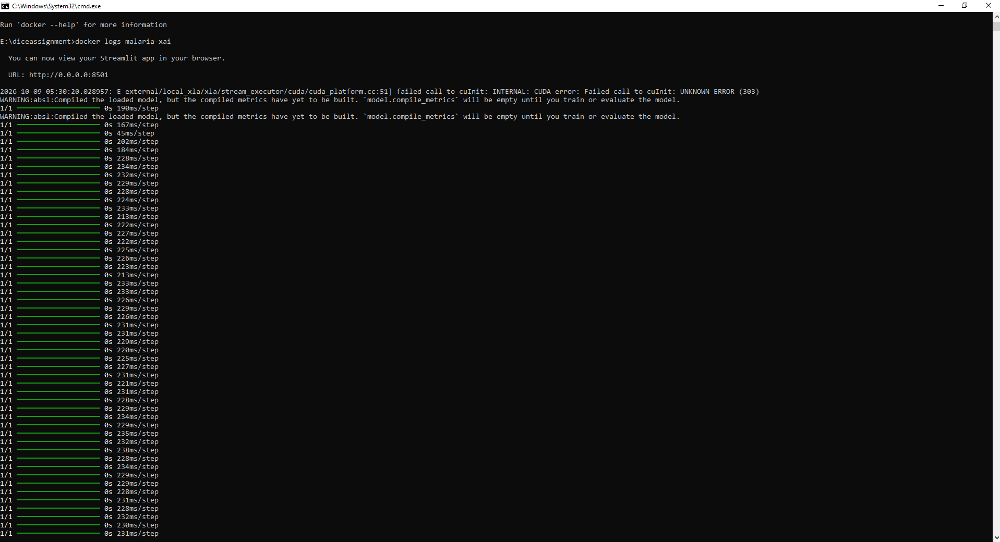
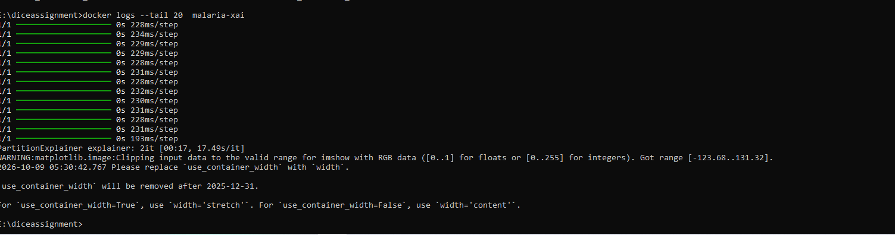
*Description: The docker logs malaria-xai command displays the output produced inside the container. The logs confirm that the Streamlit application started successfully on port 8501. A CUDA initialisation error appears at startup because no GPU is available inside the container, but it is non-fatal as TensorFlow falls back to the CPU. The repeated 1/1 lines show the model making predictions while the SHAP explainer generates the explanation. The docker logs --tail 20 malaria-xai command shows only the last 20 lines, which contain the explainer finishing along with two minor warnings from matplotlib and Streamlit. Overall, the logs show that the application is running and working correctly.*

#### 'docker inspect' command to view the details of a container
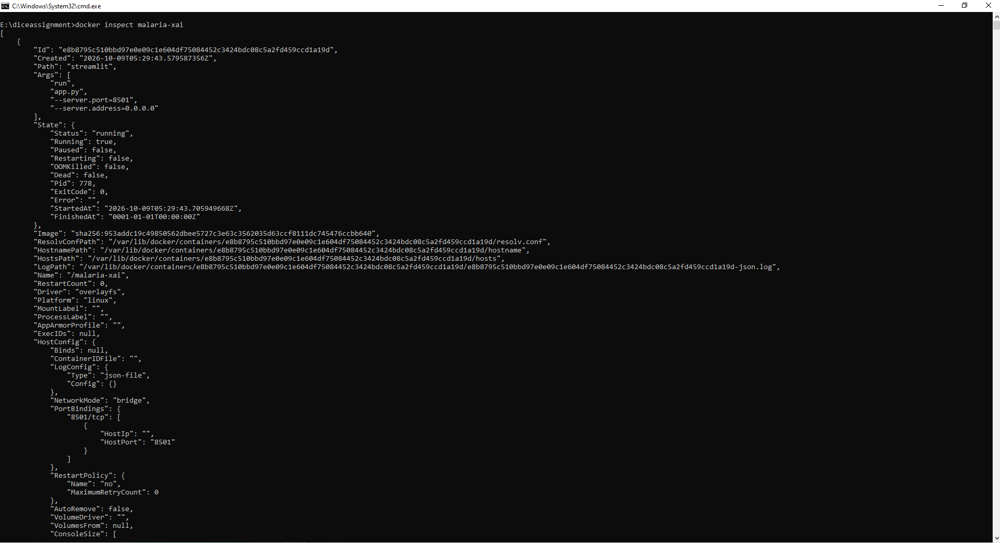
*Description: The docker inspect malaria-xai command is run to obtain the complete low-level configuration and runtime details of the container in JSON format, which docker ps only summarises, so that the setup can be verified and any problems diagnosed. The output shows that the container’s state is running, with an exit code of 0, an empty error field, OOMKilled set to false, and a restart count of 0, meaning it has run without crashes, memory failures, or restarts. The startup command is streamlit run app.py --server.port=8501 --server.address=0.0.0.0, the platform is Linux, and the network mode is bridge. The port binding confirms that container port 8501/tcp is mapped to host port 8501, the restart policy is no, and logs are stored using the json-file driver. The image hash also matches the digest of pda2/malaria-xai-app:latest pulled from Docker Hub, confirming that the container runs the published image. Overall, the finding is that the container is healthy and configured exactly as specified in the docker run command.*

#### 'docker exec' command to execute a command inside a running container

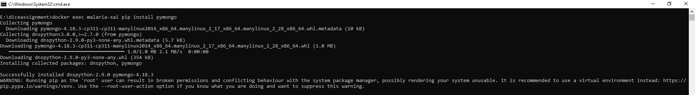

*Description: The docker exec malaria-xai pip install pymongo command is run to execute a command inside the already running container, in this case to install the pymongo library so that the application can connect to the MongoDB database. The output shows that pip downloaded pymongo 4.18.3 together with its dependency dnspython 2.9.0, using the wheels built for Python 3.11 on Linux, and both were installed successfully. A warning appears at the end stating that pip is being run as the root user, which is the default user inside the container; this is only a recommendation to use a virtual environment and does not affect the installation. Overall, the finding is that the required MongoDB driver was added to the running container without stopping or rebuilding it.*

### 'docker attach' command to attach to a running container 
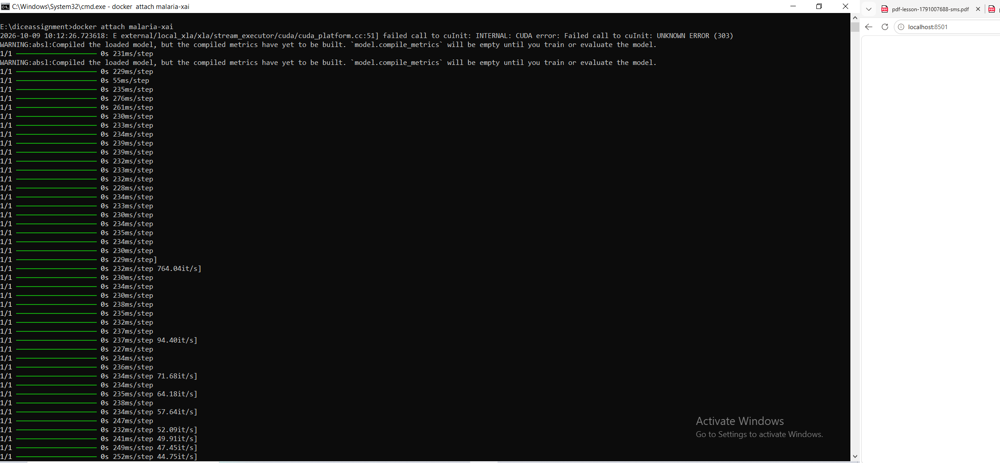
*Description: The docker attach malaria-xai command is run to connect the terminal directly to the main process of the running container, so that its output can be watched live as the application is being used, unlike docker logs, which prints what has already been recorded. The output appears while the application is opened in the browser at localhost:8501 and an image is submitted. It begins with the CUDA initialisation error, which occurs because no GPU is available inside the container and is non-fatal since TensorFlow falls back to the CPU, followed by warnings that the loaded model’s metrics have not yet been built. The repeated 1/1 lines at roughly 230 ms per step, along with the iteration rates shown beside them, are the model predictions made in real time while the SHAP explainer computes the explanation. Overall, the finding is that the terminal is successfully attached to the container and the application is actively processing a request and producing predictions.*

### 'docker commit' command to create a new image from a container 

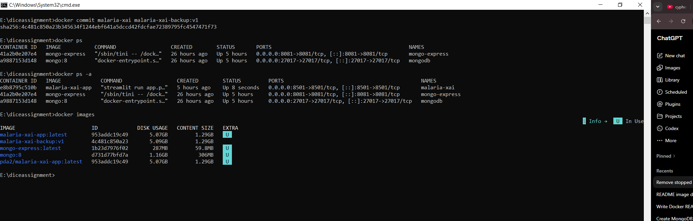

*Description: The docker commit malaria-xai malaria-xai-backup:v1 command is run to save the current state of the container as a new image, so that changes made inside it after it was started, such as the pymongo installation, are preserved and can be reused or restored later. Docker returned the SHA-256 ID of the new image to confirm that it was created. The docker ps -a output shows the malaria-xai container running with port 8501 published, alongside mongo-express and mongodb. The docker images command then lists the new image malaria-xai-backup:v1 with the ID 4c481c850a23. Its disk usage is 5.09 GB compared with 5.07 GB for the original malaria-xai-app:latest, and this small increase reflects the extra layer containing the changes made in the container. The list also shows that malaria-xai-app:latest and pda2/malaria-xai-app:latest share the same ID 953addc19c49, confirming they are the same image under two names, and the U marker indicates which images are currently in use by a container. Overall, the finding is that a backup image of the modified container was created successfully and is available locally.*

### 'docker stats' command to view the resource usage of containers
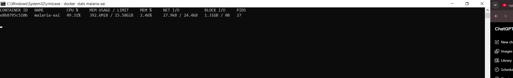
*Description: The docker stats malaria-xai command is run to monitor the live resource consumption of the container, which helps check whether the application is running efficiently and within the limits of the host machine. The output shows that the malaria-xai container is using 49.31% CPU, which is about half of one processor core and reflects the model actively processing at that moment. Memory usage is 392.6 MiB out of the 15.58 GiB available, only 2.46%, so the container is well within its limit. Network I/O is small at 27.9 kB received and 24.4 kB sent, corresponding to the browser requests made to the Streamlit application. Block I/O shows 1.31 GB read from disk and 0 B written, which reflects the application loading its libraries and the trained model at startup without writing anything back. The container is running 27 processes or threads. Overall, the finding is that the application is using a moderate amount of CPU and very little memory, with no sign of resource strain.*

### 'docker top' command to view the running processes inside a container
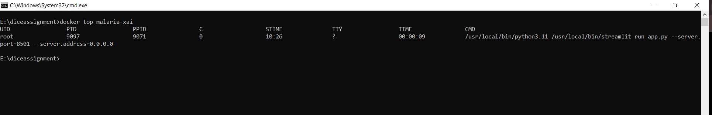

*Description: The docker top malaria-xai command is run to list the processes currently running inside the container, which helps confirm that the intended application process is active and that nothing unexpected is running alongside it. The output shows a single process, owned by the root user, with process ID 9097 and parent process ID 9071. Its command is /usr/local/bin/python3.11 /usr/local/bin/streamlit run app.py --server.port=8501 --server.address=0.0.0.0, confirming that the container is running the Streamlit application with Python 3.11 on port 8501. The process started at 10:26 and has used 9 seconds of CPU time, while the C value of 0 indicates negligible CPU use at the moment of the check. The ? under TTY shows that no terminal is attached, which is expected for a container started in detached mode. Overall, the finding is that the container runs exactly one main process, the Streamlit application, and it is active. The count of 27 shown earlier under PIDS in docker stats refers to the threads belonging to this one process.*

### 'docker start' command to start a stopped container 
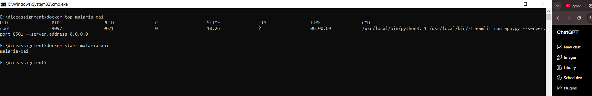

*Description: The docker start malaria-xai command is run to start an existing container that has been stopped, without creating a new one, so the container keeps its ID, name, port mapping, and any changes made inside it. This differs from docker run, which always creates a fresh container from an image. In the output, Docker returned the container name malaria-xai, which confirms that the command was accepted and the container is in the running state. Overall, the finding is that the existing malaria-xai container can be brought back into operation with a single command and the application becomes available again on port 8501.*

### 'docker pause' command to pause a running container 
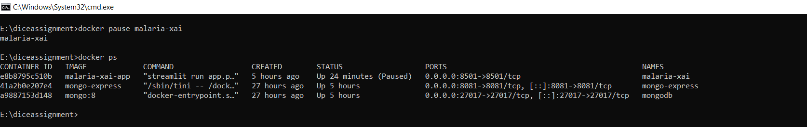
*Description: The docker pause malaria-xai command is run to temporarily suspend all processes inside the container without stopping it, which is useful for freeing up CPU for other tasks while keeping the container’s state intact. Docker returned the container name to confirm the action. The following docker ps shows malaria-xai with the status Up 24 minutes (Paused), while mongo-express and mongodb continue running normally. Unlike a stopped container, a paused one still appears in the list of running containers, keeps its port mapping on 8501, and retains everything held in memory, but its processes are frozen, so the application will not respond to browser requests until it is resumed. Overall, the finding is that the container was paused successfully and remains in a suspended state, ready to continue from exactly where it left off with docker unpause malaria-xai.*

### 'docker unpause' command to unpause a paused container
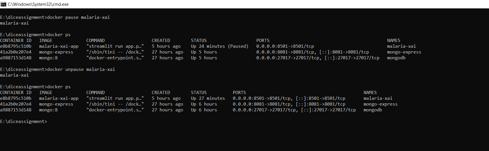
*Description: The docker unpause malaria-xai command is run to resume a paused container, so that its processes continue from exactly where they were suspended. Docker returned the container name to confirm the action. The docker ps output before the command shows malaria-xai with the status Up 24 minutes (Paused), and the output after it shows Up 27 minutes with the (Paused) label removed. The uptime carried on from 24 to 27 minutes instead of resetting, which confirms that the container was resumed and not restarted, so the application kept its loaded model and in-memory state. Port 8501 is published on both IPv4 and IPv6 again, and the mongo-express and mongodb containers were unaffected throughout. Overall, the finding is that the container was successfully resumed and the application is available again on port 8501.*
### 'docker rename' command to rename a container
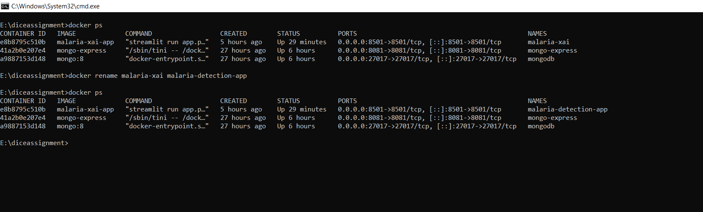
*Description: The docker rename malaria-xai malaria-detection-app command is run to change the name of an existing container, giving it a clearer and more descriptive name without having to remove and recreate it. The command produces no output, which in Docker indicates that it completed successfully. The docker ps output before the command lists the container as malaria-xai, and the output after it shows the name changed to malaria-detection-app. The container ID e8b8795c510b, the image, the port mapping on 8501, and the uptime of 29 minutes are all identical in both listings, which confirms that only the name changed and the container kept running without interruption. Overall, the finding is that the container was renamed successfully while the application remained available.*

### 'docker port' command to display the public-facing port that a container is 
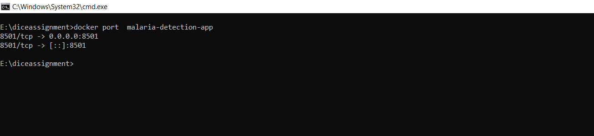
*Description: The docker port malaria-detection-app command is run to display the port mappings of a specific container, which is a quick way to confirm on which host port the application can be reached without reading through the full docker ps or docker inspect output. The output shows two entries: 8501/tcp -> 0.0.0.0:8501 and 8501/tcp -> [::]:8501. This means the container’s internal TCP port 8501, on which Streamlit listens, is published to port 8501 on the host for all IPv4 addresses (0.0.0.0) and all IPv6 addresses ([::]). Overall, the finding is that the port mapping set with the -p 8501:8501 option is active, and the application is reachable from the host at http://localhost:8501.*

### 'docker update' command to update a container's resource limits

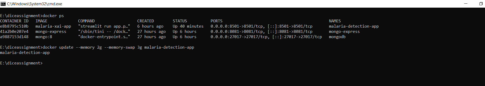
*Description: The docker update --memory 2g --memory-swap 3g malaria-detection-app command is run to change the resource limits of a running container without stopping or recreating it, in order to prevent the application from consuming too much of the host’s memory. The docker ps output beforehand confirms that the container is running and has been up for 40 minutes. The --memory 2g option limits the container to 2 GB of RAM, and --memory-swap 3g sets the combined total of RAM and swap to 3 GB, which leaves 1 GB of swap space available once the RAM limit is reached. Docker returned the container name to confirm that the new limits were applied. Since the earlier docker stats output showed the application using about 392 MiB, the 2 GB limit leaves ample room for normal operation. Overall, the finding is that the memory limits of the container were updated successfully while the application continued running.*

### 'docker restart' command to restart a running container
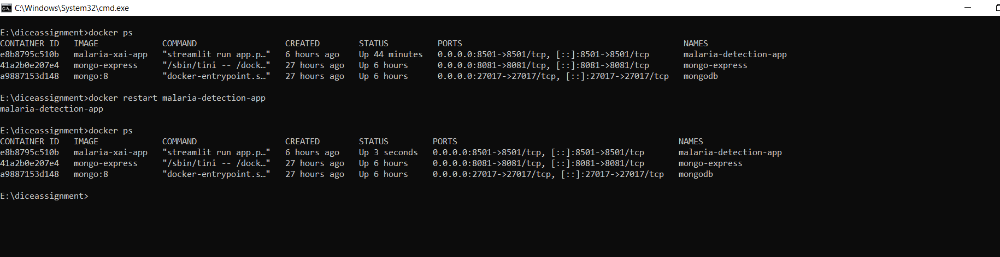
*Description: The docker restart malaria-detection-app command is run to stop and immediately start a container in a single step, which is commonly used to apply configuration changes or to recover an application that has become unresponsive. Docker returned the container name to confirm the action. The docker ps output before the command shows the container with the status Up 44 minutes, and the output after it shows Up 3 seconds. The uptime resetting confirms that the main process was actually stopped and started again, unlike the earlier pause and unpause where the uptime carried on. The container ID e8b8795c510b, the name, the image, and the port mapping on 8501 are unchanged, and the creation time still reads 6 hours ago, showing that the same container was restarted and no new one was created. The mongo-express and mongodb containers were unaffected. Overall, the finding is that the container was restarted successfully and the application is running again on port 8501.*